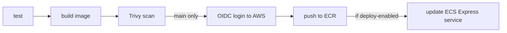

# mini-idp-workflows

A reusable GitHub Actions workflow that takes a containerized Python service from commit to running service on AWS: **test → build → scan → push to ECR → deploy to ECS Express Mode**, authenticated with GitHub OIDC (no AWS access keys stored anywhere).

This is a personal learning project: a scaled-down "golden path" for practising reusable CI/CD, identity federation and container deployment on AWS. It is not production-hardened and comes with no warranty.

## What it does



| Event | What runs |
|---|---|
| Pull request | test, build, scan. **No AWS access.** |
| Push to `main` | all of the above, then OIDC login and push to ECR (tags: commit SHA and `latest`) |
| Push to `main` with `deploy-enabled: true` | additionally updates the ECS Express Mode service to the new SHA-tagged image |

The image is deployed by commit SHA, so every rollout is traceable to a commit.

## Quick start

Call the workflow from your service repo, for example `.github/workflows/ci.yml`:

```yaml
name: CI/CD

on:
  push:
    branches: [main]
  pull_request:
    branches: [main]

permissions:
  id-token: write   # required: lets the called workflow request an OIDC token
  contents: read

jobs:
  ci:
    uses: simonschlaeppi/mini-idp-workflows/.github/workflows/container-deploy.yml@v1
    with:
      role-to-assume: arn:aws:iam::<account-id>:role/<your-github-role>
      ecr-repository: my-service
      service-name: my-service
      install-command: pip install -r requirements.txt -r requirements-dev.txt
      test-command: python -m pytest
      deploy-enabled: ${{ vars.DEPLOY_ENABLED == 'true' }}
```

Pin to a version tag (`@v1`) or a commit SHA, not `@main`.

## Inputs

| Input | Required | Default | Description |
|---|---|---|---|
| `role-to-assume` | yes | | ARN of the IAM role the workflow assumes via OIDC |
| `ecr-repository` | yes | | Name of an existing ECR repository |
| `service-name` | yes | | Name of the ECS Express Mode service (cluster `default`) |
| `aws-region` | no | `eu-central-1` | Region of ECR and the service |
| `python-version` | no | `3.12` | Python version for the test job |
| `install-command` | no | `pip install -r requirements.txt` | Installs the test dependencies |
| `test-command` | no | `python -m pytest` | Runs the tests |
| `container-port` | no | `8000` | Port the container listens on |
| `secret-env-name` | no | empty | Environment variable name for an injected secret |
| `secret-arn` | no | empty | Secrets Manager ARN for that variable (skipped when empty) |
| `deploy-enabled` | no | `false` | Run the deploy step on `main`. Useful as a cost switch. |

The workflow takes no secrets. Authentication happens through OIDC.

## What your repo needs

**In your repo**
- A `Dockerfile` at the repository root.
- Tests that pass with `test-command`.
- `permissions: id-token: write` in the calling workflow. A called workflow cannot get more permissions than its caller grants.

**In AWS**
1. An IAM OIDC identity provider for `token.actions.githubusercontent.com` (audience `sts.amazonaws.com`).
2. An IAM role with a trust policy scoped to your repo and branch:

```json
{
  "Version": "2012-10-17",
  "Statement": [{
    "Effect": "Allow",
    "Principal": {
      "Federated": "arn:aws:iam::<account-id>:oidc-provider/token.actions.githubusercontent.com"
    },
    "Action": "sts:AssumeRoleWithWebIdentity",
    "Condition": {
      "StringEquals": {
        "token.actions.githubusercontent.com:aud": "sts.amazonaws.com",
        "token.actions.githubusercontent.com:sub": "repo:<owner>/<repo>:ref:refs/heads/main"
      }
    }
  }]
}
```

For a reusable workflow, the `sub` claim still identifies the **calling** repo and ref, so the trust policy is the same as without a template.

3. Permissions on that role, scoped to your resources:
   - ECR push: `ecr:GetAuthorizationToken` (must be on `*`), plus layer upload, `PutImage` and `BatchGetImage` actions on your repository
   - Deploy (only if you use it): `ecs:UpdateExpressGatewayService`, `ecs:DescribeExpressGatewayService`, `ecs:RegisterTaskDefinition`, `ecs:DescribeTaskDefinition`, `ecs:UpdateService`, `ecs:DescribeServices`, and `iam:PassRole` on the task execution and infrastructure roles of the service
4. An ECR repository, and for the deploy step an existing ECS Express Mode service.

If a run fails with `AccessDeniedException`, the message names the missing action. Add it, re-run, and you end up with a least-privilege policy.

## Good to know

- **Required status checks are renamed.** Jobs from a reusable workflow are reported as `<caller job> / <called job>` (for example `ci / test`). Update branch rulesets that require checks.
- **Trivy fails the build** on fixable HIGH and CRITICAL vulnerabilities in the image. Older findings with no fix available are ignored.
- **Cost:** ECR and GitHub Actions on public repos are cheap or free. A running Express Mode service is not: a small Fargate task plus the load balancer and public IPv4 addresses come to roughly $1 per day. Delete the service when you are not testing, and keep `deploy-enabled` off while it does not exist.
- **Deployments are gradual.** Express Mode rolls out with a canary. A green workflow means the update was accepted, not that the new version is live. Check `rolloutState` with `aws ecs describe-services`.

## Security notes

- Workflow inputs are passed to shell steps through environment variables, never interpolated directly into scripts.
- Third-party actions are pinned to commit SHAs where they are not published by GitHub or AWS.
- No long-lived credentials: the role is assumed with a short-lived OIDC token and the temporary credentials expire after about an hour.
- This repository is scanned with CodeQL, secret scanning and Dependabot.

## Limitations

- Python services with a Dockerfile at the repo root, deployed to ECS Express Mode only.
- Assumes the ECS cluster `default`.
- No multi-environment promotion (dev → prod) yet.
- Not tested beyond my own setup.
- The deploy step has not been run through the template yet. The same ECS call was proven as a standalone workflow step, and the step will change when the infrastructure moves to OpenTofu.

## Versioning

Releases follow semantic versioning with a moving major tag: `v1.0.0`, `v1.1.0`, and `v1` pointing at the latest `v1.x.y`. Breaking changes to inputs or behaviour get a new major version.

## Roadmap

- Infrastructure as code (OpenTofu) for the registry, network and compute that Express Mode creates automatically
- A scaffolding script that generates a new service repo from a template
- Optional extra stages: SBOM, image signing
